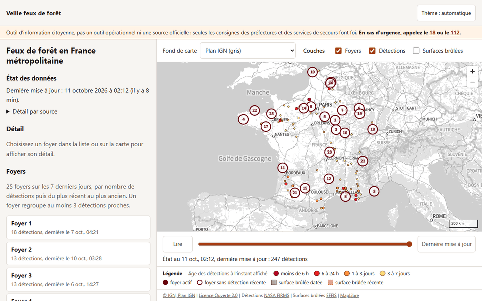
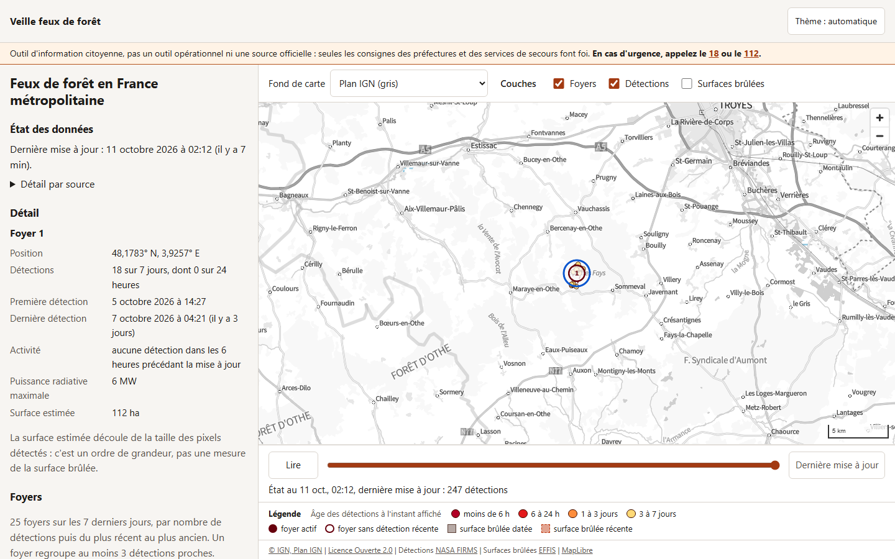
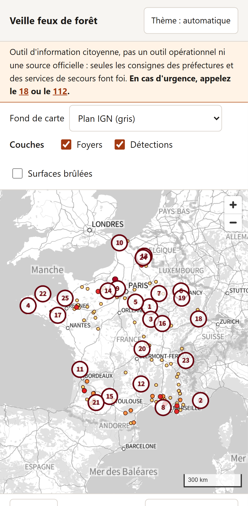

# veille-feux-foret

Carte citoyenne des feux de forêt en France métropolitaine : situation des foyers, prévision à quelques heures, imagerie et lecture dans le temps.

Outil d'information citoyenne, pas un outil opérationnel ni une source officielle. En cas d'urgence, appelez le 18 ou le 112.

## État du projet

Le projet est construit par lots, chacun livré par une ou plusieurs pull requests testées.

| Lot | Contenu | État |
|---|---|---|
| 1a | Dépôt, intégration continue, contrôles de sécurité, capture de fixtures | fusionné (PR n°1) |
| 1b | Carte, foyers FIRMS, périmètres EFFIS, frise temporelle, déploiement | terminé : PR n°3 et n°6 à n°10, puis la PR de clôture (comparaison, captures) |
| 2 | Prévision : vent, météo AROME, propagation | en cours : capture des réponses d'Open-Meteo (PR n°14), fichiers de vent et de météo dans le pipeline (PR n°15), vent animé sur la carte |
| 3 | Imagerie et temps : comparaison, imagerie, relief 3D, fumée | à venir |
| 4 | Situation : foyers nommés par commune, score de menace, danger Météo-France, moyens aériens, enjeux exposés | à venir |
| 5 | Fil d'information et archive | à venir |

Démo en ligne : <https://veille-feux-foret.hamonthibaud.workers.dev>, mise à jour toutes les 30 minutes.

## Ce que montre la carte

- **Foyers** : détections satellite NASA FIRMS (VIIRS et MODIS) des 7 derniers jours en France métropolitaine, hors sites industriels connus, regroupées en foyers d'au moins 3 détections proches. Chaque foyer a sa fiche : position, nombre de détections, première et dernière détection, activité, puissance radiative, surface estimée présentée comme un ordre de grandeur.
- **Détections** colorées selon leur âge à l'instant affiché : moins de 6 heures, 6 à 24 heures, 1 à 3 jours, 3 à 7 jours.
- **Frise des 7 derniers jours**, heure par heure : la carte montre l'état à l'instant choisi (détections acquises jusque-là, foyers déjà apparus), avec lecture automatique.
- **Surfaces brûlées** Copernicus EFFIS, datées et récentes, chargées seulement quand la couche est activée.
- **Vent à 10 m** du modèle AROME HD de Météo-France (données Open-Meteo), à l'heure de la frise : traits animés qui suivent le vent, ou flèches fixes (bouton de pause, et au départ si le système demande de réduire les animations). Un clic sur la carte donne le vent, les rafales et la direction au point. Couche désactivée par défaut, chargée à la demande.
- **Bilan de la saison** en France selon EFFIS, comparé à la moyenne depuis 2006.
- **État des données** : heure de la dernière mise à jour, retard ou ancienneté signalés, état de chaque source, sources en panne nommées. Aucune donnée n'est inventée : une source absente est signalée comme telle.
- **Deux fonds de carte** : Plan IGN gris par défaut, OpenStreetMap (OpenFreeMap, style Positron) au choix ; si un fond ne répond pas, l'autre est proposé.
- **Partage** par l'adresse : position de la carte, fond, instant, foyer choisi, couches des surfaces brûlées et du vent.
- Thème clair ou sombre, mise en page mobile, navigation au clavier, liste des foyers utilisable sans la carte (et sans WebGL).

### Aperçu



| Bureau | Mobile |
|---|---|
|  |  |

Captures et animation prises sur le site en ligne avec `npm run captures:demo` (voir Développement). Les autres vues, thème sombre et fond OpenStreetMap, sont dans `docs/captures/en-ligne/`.

## Comparaison avec les projets d'origine

D'après le texte intégral de leurs README, relu le 10 octobre 2026. Deux cases de carte-incendies viennent de son code (licence MIT) et le disent. Le README de feux-france décrit désormais un observatoire plus large, OMNI (feux, épidémies, conflits) : seule sa partie sur les feux est comparée. « Non indiqué » veut dire que le README n'en parle pas, pas que la fonctionnalité manque.

| Fonctionnalité | carte-incendies | Flamap | feux-france | veille-feux-foret |
|---|---|---|---|---|
| Zone couverte | France métropolitaine | France métropolitaine, Espagne et Portugal (péninsule couverte plus légèrement) | France | France métropolitaine |
| Détections satellite NASA FIRMS | VIIRS (3 satellites) et MODIS, 7 jours | VIIRS et MODIS, 10 jours | VIIRS (3 satellites), rafraîchies environ toutes les 3 heures | VIIRS (3 satellites) et MODIS, 7 jours, état de chaque flux affiché |
| Sites industriels à chaleur permanente écartés | oui, 21 sites (d'après son code) | non indiqué (cités parmi les faux positifs possibles) | non indiqué | oui, liste reprise de carte-incendies |
| Regroupement en foyers | foyers actifs avec emprise estimée, cumul sur 7 jours et compte sur 24 heures | non indiqué | foyers nommés par commune, contours, tendance, reprise après 48 heures | foyers d'au moins 3 détections, avec emprise et fiche ; nom de commune au lot 4 |
| Surfaces brûlées Copernicus EFFIS | datées (surface, commune) et récentes, régénérées toutes les 6 heures | saison en cours | non indiqué | datées et récentes, chargées à la demande |
| Bilan de la saison | oui, statistiques EFFIS (d'après son code) | non indiqué | non indiqué | oui, comparé à la moyenne depuis 2006 |
| Incendies signalés, évacuations | situation officielle et évacuations saisies à la main à partir des communiqués | incendies signalés par l'association PSFDF, avec leur statut | communiqués des préfectures dans le fil d'information | non prévu à ce jour, à décider |
| Frise temporelle | 7 jours passés et 12 heures de prévision, lecture animée | 10 jours, détections regroupées par passage satellite, lecture qui accélère dans les creux | semaine rejouée heure par heure, avec le vent et les rotations aériennes | 7 jours heure par heure, lecture animée, âge des détections à l'instant choisi ; prévision au lot 2, curseur continu au lot 3 |
| Vent animé | oui, Open-Meteo, vent actuel ou prévu | oui, AROME HD (France), ARPEGE (péninsule) | oui | oui, AROME HD (Open-Meteo) à l'heure de la frise, flèches fixes au choix, vent au point cliqué |
| Météo au point | non indiqué | prévisions horaires d'un point | AROME au foyer, vent mesuré à la station la plus proche, prévision d'ensemble, normales climatiques | lot 2 |
| Prévision de propagation | panaches heure par heure, communes sous le vent, présentés comme estimations non officielles | non indiqué | trajectoire de propagation sur 6 heures | lot 2, méthode et limites documentées |
| Fumée simulée | non indiqué | oui, présentée comme indicative | non indiqué | lot 3 |
| Imagerie | non indiqué | orthophotos IGN, Sentinel-2 sans nuages ailleurs | imagerie NASA GIBS par foyer, fond satellite | lot 3, avec relief 3D et comparaison avant / après |
| Autres couches | non indiqué | non indiqué | radar de pluie, qualité de l'air, carte de chaleur, cartes choroplèthes (activité, danger, vigilance) | non prévu à ce jour |
| Moyens aériens (ADS-B) | non indiqué | oui, cap et fiche de vol | oui, Sécurité civile et renforts européens, trajectoires synchronisées avec la frise | lot 4 |
| Score de menace | non indiqué | non indiqué | oui, de 0 à 100 | lot 4, composantes et pondérations affichées |
| Danger et vigilance Météo-France | non indiqué | non indiqué | oui | lot 4 |
| Population et sites sensibles exposés | non indiqué | non indiqué | oui, à 10 km et 3 km | lot 4 |
| Fil d'information | non indiqué | non indiqué | presse, réseaux sociaux, communiqués, vidéos, synthèse par IA | lot 5, sources à valider |
| Archive | non indiqué | oui, hors du site : page « Feux archivés » qui rejoue chaque feu suivi par PSFDF | oui, historique SQLite | lot 5, stockage à décider |
| Alertes | non indiqué | notifications des nouveaux foyers dans un rayon de 5 à 50 km | alerte combinant vent et canicule | non prévu à ce jour |
| Export d'image | non indiqué | PNG ou GIF de l'évolution | non indiqué | non prévu à ce jour |
| Partage d'une vue par l'adresse | non indiqué | position et zoom | non indiqué | position, fond, instant, foyer et couches |
| État des données affiché | non indiqué | panneau « Mises à jour des données » | non indiqué | état de chaque source ; retard, ancienneté et reprise des données précédentes signalés |
| Mise à jour des données | page actualisée toutes les 10 minutes, surfaces brûlées toutes les 6 heures | toutes les 30 minutes, température toutes les 6 heures | collecte toutes les 30 minutes | toutes les 30 minutes : du 7 au 10 octobre 2026, 148 runs pour 148 passages, 147 réussis |
| Panne d'une source | non indiqué | publication annulée, carte en ligne inchangée | non indiqué | données précédentes reprises et signalées comme anciennes |
| Hébergement | serveur Python (Render ou Docker) | fichiers statiques sur GitHub Pages, serveur séparé pour l'archive | serveur Node.js et SQLite (Docker sur un serveur privé) | fichiers statiques sur Cloudflare Workers, sans serveur |
| Clés d'API | jeton Mapbox | aucune | facultatives (Exa, OpenRouter, Météo-France, OpenSky) | aucune |
| Thème sombre et accessibilité testée | non indiqué | non indiqué | non indiqué | thèmes clair et sombre, mobile, tests automatisés WCAG 2.2 AA et clavier |
| Tests publiés | vérification des fichiers de situation en CI | tests Python et JavaScript sans réseau, en CI | `npm test`, typage et build en CI | unitaires, end-to-end sur 3 navigateurs, Lighthouse, analyses de sécurité (TESTS.md, SECURITY.md) |
| Licence du code | MIT | aucune | aucune indiquée | MIT |

## Architecture

```
pipeline/   Python : collecte et normalisation des sources publiques (GitHub Actions)
web/        Vite + TypeScript + MapLibre GL JS : application statique, servie par Cloudflare Workers
fixtures/   échantillons réels des sources, utilisés par les tests
.github/    intégration continue, contrôles de sécurité, capture des fixtures
```

Le pipeline tourne dans GitHub Actions et produit des fichiers statiques que l'application lit : la commande `veille-feux-build` collecte les détections FIRMS des 7 derniers jours, les regroupe en foyers, lit les surfaces brûlées et le bilan de la saison publiés par EFFIS, lit le vent et la météo du modèle AROME HD de Météo-France sur Open-Meteo (une grille de vent sur la France et la météo de chaque foyer actif dans les 24 dernières heures, demandées de nouveau à chaque nouveau calcul du modèle, toutes les 3 heures), et écrit un fichier d'état de chaque source. Quand une source ne répond pas, la commande reprend les fichiers du déploiement précédent et les signale comme anciens : une panne ne vide jamais la carte et ne fait jamais passer une donnée ancienne pour récente. Le site est servi par Cloudflare Workers en fichiers statiques : les requêtes y sont gratuites et sans plafond, ce qui garde le site disponible lors des pics de consultation pendant les grands feux, et les en-têtes de sécurité sont définis dans `web/public/_headers`. En local, `npm run serve` sert le build avec le même moteur (wrangler) et les mêmes en-têtes. Aucun serveur n'est nécessaire tant que les lots 1 à 4 le permettent ; le besoin d'un back-end sera tranché avant le lot 5.

Dans le navigateur, la page lit les fichiers de `data/` (état, détections, foyers, emprises, bilan ; surfaces brûlées et vent à la demande), vérifie chaque entrée et affiche l'état, la liste des foyers et le bilan avant même que la carte soit chargée. La carte (MapLibre GL JS) est chargée ensuite ; ses tuiles viennent directement des serveurs de l'IGN ou d'OpenFreeMap. MapLibre est publié tel quel dans le build, une seule fois pour la page et son worker. Le vent est dessiné par une couche WebGL 2 propre au site (couche personnalisée de MapLibre) : les particules et les flèches sont calculées en TypeScript, sans bibliothèque supplémentaire.

## Mise à jour et déploiement

Le workflow **Deploy** (`.github/workflows/deploy.yml`) est lancé toutes les 30 minutes par un déclencheur hébergé chez Cloudflare (voir plus bas), à chaque fusion dans `main` et à la demande depuis l'onglet Actions. Sa propre planification GitHub (à 7 et 37 minutes de chaque heure) reste en secours. Il a deux jobs :

1. **construction**, sans aucun secret : relecture des fichiers de données du site déployé, pour les reprendre si une source ne répond pas (seuls les fichiers bien formés sont repris) ; collecte des sources et construction des données (`veille-feux-build`), avec l'état de chaque source publié en annotation du run ; construction du site avec ses données ;
2. **déploiement**, dans l'environnement GitHub `production` qui n'accepte que la branche `main` et seul à recevoir les identifiants Cloudflare : installation de wrangler sans exécuter aucun script d'installation, déploiement sur Cloudflare Workers (`wrangler deploy`), puis vérification du site déployé (`tools/check_deployment.py`) : fichier d'état servi identique à celui qui vient d'être construit, en-têtes de sécurité présents, chemins inconnus et fichier `_headers` en 404.

Si aucune détection n'est disponible, ni fraîche ni reprise, le run échoue avant le déploiement : le site garde sa version précédente. Chaque source a un délai de réponse limité, pour que la construction ne dépasse pas une dizaine de minutes même si toutes les sources traînent. L'adresse `veille-feux-foret.hamonthibaud.workers.dev` suppose que le sous-domaine `hamonthibaud.workers.dev` du compte Cloudflare existe déjà, ce qui est le cas.

**Déclencheur.** GitHub retarde ou saute une grande partie des tâches planifiées : du 5 octobre 2026 à 15 h UTC au 6 octobre à 8 h UTC, 2 des 34 runs planifiés de Deploy ont démarré. Un petit Worker distinct, `veille-feux-foret-trigger` (`web/trigger/`), est donc lancé par une tâche planifiée de Cloudflare à 7 et 37 minutes de chaque heure (UTC) et demande à GitHub, par son API, de lancer Deploy sur `main`. Il n'a pas d'adresse publique et ne fait rien d'autre. Le Worker est déployé par le workflow **Deploy trigger** (`.github/workflows/trigger.yml`) quand son code change. Du 7 octobre 2026 à 15 h 37 UTC au 10 octobre à 17 h 07 UTC, il a lancé Deploy à chacun des 148 passages prévus (détail dans TESTS.md). Si GitHub refuse la demande (jeton expiré, par exemple), l'invocation échoue et son message reste 3 jours dans les journaux du Worker chez Cloudflare (Workers & Pages, `veille-feux-foret-trigger`, Logs) ; la planification GitHub continue de lancer Deploy quand elle le peut.

Son seul secret, `GITHUB_TOKEN`, est créé une fois à la main :

1. sur GitHub, un jeton à accès fin (Settings, Developer settings, Personal access tokens, Fine-grained tokens) limité au seul dépôt `t-hamon/veille-feux-foret`, avec la seule permission de dépôt « Actions » en lecture et écriture, et une expiration à un an ;
2. chez Cloudflare, dans Workers & Pages, `veille-feux-foret-trigger`, Settings, Variables and Secrets, une variable `GITHUB_TOKEN` de type **Secret** (pas Text : une variable Text serait supprimée au déploiement suivant du Worker).

## Développement

Prérequis : Python 3.11 ou plus, Node.js 24.15 ou plus (version LTS active, maintenue jusqu'en avril 2028). Avec une version plus ancienne, `npm ci` s'arrête avec un message explicite.

Linux, macOS, Git Bash :

```bash
# Pipeline
cd pipeline
python -m venv .venv && . .venv/bin/activate
pip install -e ".[dev]"
ruff check . && mypy src tests && pytest
veille-feux-build ../donnees   # collecte réelle, demande un accès réseau aux sources

# Application
cd ../web
npm ci
npm run dev          # serveur de développement
npm run build        # build de production dans web/dist
npm run serve        # sert le build avec le moteur de Cloudflare et ses en-têtes
npm test             # tests unitaires avec couverture
npx playwright install chromium firefox webkit
npm run test:e2e     # tests end-to-end sur le build local
npm run captures     # captures et animation du build (npm run serve doit tourner)
npm run captures:demo  # captures et animation du site en ligne
```

Les tests end-to-end n'interrogent aucun serveur tiers : les fonds de carte sont remplacés par un style local minimal, et les fichiers de données sont ceux que le pipeline écrit à partir de la capture du 3 octobre 2026, et de celle du 12 octobre 2026 pour le vent (`web/e2e/fixtures/`, produits par `tools/build_web_fixtures.py`). Les captures d'écran, elles, chargent les vrais fonds de carte et demandent donc un accès réseau.

Windows PowerShell (une commande par ligne, `&&` n'existe pas dans PowerShell 5.1) :

```powershell
cd pipeline
python -m venv .venv
.\.venv\Scripts\Activate.ps1
pip install -e ".[dev]"
pytest
deactivate
cd ..\web
npm ci
npm test
npm run build
npx playwright install chromium firefox webkit
npm run test:e2e
```

Captures d'écran sous Windows : lancer `npm run serve` dans un premier terminal, puis `npm run captures` dans un second, depuis le dossier `web`. Pour le site en ligne, `npm run captures:demo` suffit, sans serveur local. Chacune écrit sept captures, dont deux du vent (animé, puis en flèches fixes), et `interactions.gif` : `npm run captures` dans `docs/captures/build/` (données de test, pour comparer avant et après un changement), `npm run captures:demo` dans `docs/captures/en-ligne/` (images du README).

Si PowerShell refuse `Activate.ps1`, lancer d'abord `Set-ExecutionPolicy -Scope Process -ExecutionPolicy Bypass`, qui n'autorise les scripts que pour la fenêtre en cours.

Le détail des tests et de leurs derniers résultats est dans [TESTS.md](TESTS.md), la politique et les contrôles de sécurité dans [SECURITY.md](SECURITY.md).

## Fixtures

Les tests des parseurs utilisent des réponses réelles des sources, capturées par le workflow **Capture fixtures**. Voir [fixtures/README.md](fixtures/README.md).

## Crédits

- [carte-incendies](https://github.com/lgdlcs/feux-france) de Lucas Legrand (lgdlcs) : code d'origine sous licence MIT, réutilisé et modifié.
- [Flamap](https://github.com/rozierguillaume/flamap) de Guillaume Rozier (rozierguillaume) : inspiration fonctionnelle, réimplémentation indépendante, aucun code repris.
- [feux-france](https://github.com/the20100/feux-france) de Vincent (the20100) : inspiration fonctionnelle, réimplémentation indépendante, aucun code repris.

Détail des éléments repris, sources de données et licences : [CREDITS.md](CREDITS.md).

## Limites connues

- La mise à jour dépend du déclencheur Cloudflare et de GitHub : un run demandé peut attendre une machine (le 5 octobre 2026 au soir, deux jobs de la PR n°9 n'en ont trouvé aucune en 15 minutes), et le 7 octobre l'API de lancement de GitHub a répondu par une erreur interne au moins de 15 h 07 à 15 h 13 UTC, le bouton de lancement de son interface échouant encore vers 15 h 17 (voir TESTS.md). Si le jeton du déclencheur expire, seule reste la planification GitHub, très irrégulière, que GitHub désactive en plus dans un dépôt public resté 60 jours sans activité. La page signale alors des données en retard, puis anciennes.
- Si la vérification qui suit un déploiement échoue, la version déployée reste en ligne : il n'y a pas de retour automatique à la précédente. Le run échoue et GitHub prévient le mainteneur par courriel.
- Un commit poussé sur `main` est déployé sans attendre la CI de ce commit : seules des PR dont la CI est passée sont fusionnées dans `main`.
- Une détection FIRMS est une anomalie thermique vue par satellite, pas forcément un feu de forêt. Les sites industriels connus sont écartés, mais la liste n'est pas complète : sur deux captures à deux jours d'intervalle, 4 des 5 foyers se trouvaient au même endroit, ce qui évoque des sources de chaleur permanentes non encore identifiées.
- La surface estimée d'un foyer découle de la taille des pixels détectés : c'est un ordre de grandeur, pas une mesure.
- Les foyers sont calculés à chaque mise à jour : en remontant la frise, la carte masque les foyers pas encore apparus, mais leur composition reste celle de la dernière mise à jour.
- La carte demande WebGL 2 ; sans lui, l'état des données, la liste des foyers et leurs fiches restent disponibles.
- Les fonds de carte n'ont pas de version sombre homogène : ils restent clairs en thème sombre.
- Le vent est celui d'un modèle, pas une mesure : les heures passées sont des prévisions archivées du modèle AROME HD, les heures à venir des prévisions. La grille du fichier a un pas de 0,5° (de 35 à 56 km selon la direction et la latitude) : la valeur en un point est interpolée entre les quatre points voisins et lisse les effets locaux (vallées, brises, relief). Le vent mesuré par les stations Météo-France est prévu plus tard dans le lot 2.
- La frise s'arrête encore à la dernière mise à jour : le vent prévu au-delà est dans le fichier mais pas encore affichable ; la frise étendue est la prochaine étape du lot 2.
- Le point cliqué pour le vent n'est pas marqué sur la carte ; sa position est donnée dans le panneau de détail.

## Licence

MIT, voir [LICENSE](LICENSE). La mention de copyright de carte-incendies est conservée.
